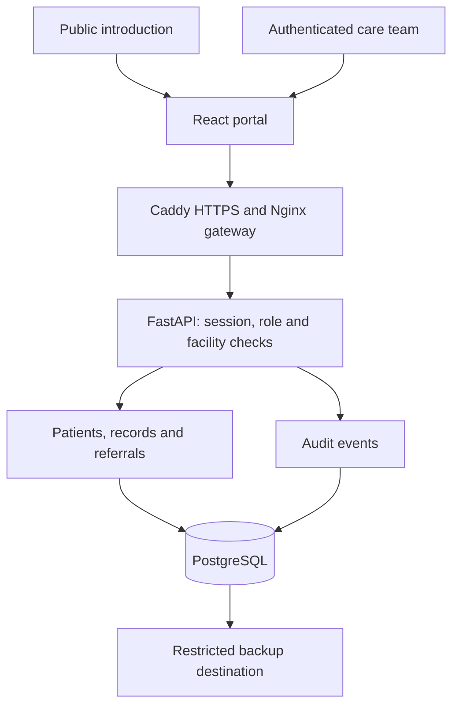
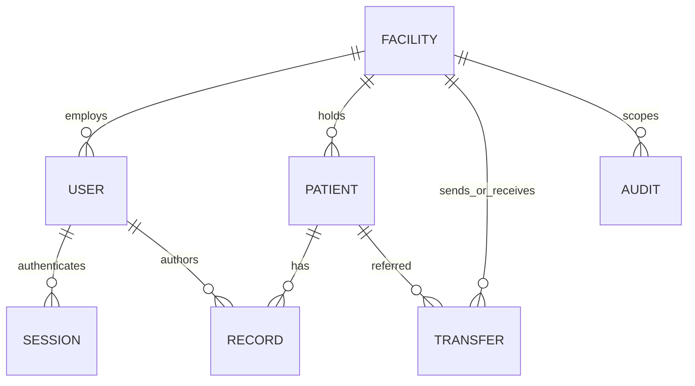
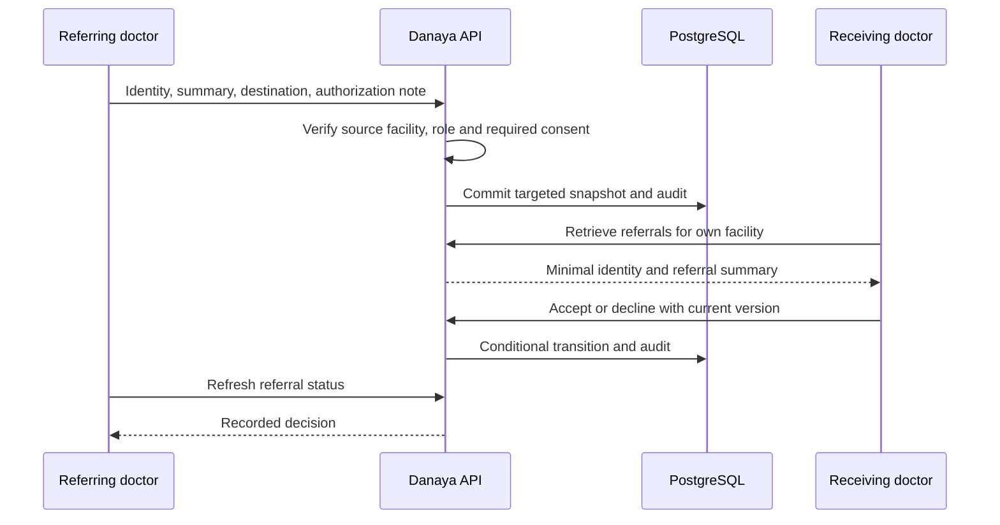

# Danaya 0.2 architecture

## Decision: one coherent clinical backend

The pilot uses a modular FastAPI application and one PostgreSQL database, with organization scoping on each clinical entity. This keeps patient, order and audit writes in a single transaction and reduces operational work for a small hospital team. Split services only when measured load or independently owned integrations justify the added complexity.

A distinct demonstration build uses an in-memory browser adapter and fictional fixtures. It is not connected to this backend and must never be used as evidence that server access controls are operating.

## Implemented boundaries

- All non-health API reads require a valid, unexpired, active account session. Passwords use per-password salts and scrypt; only SHA-256 hashes of high-entropy session tokens are stored server-side.
- Cookies are HttpOnly, SameSite=Strict, scoped to `/api`, and Secure in production. Write requests must have the exact configured Origin and `X-Danaya-Request: 1`. There is no cross-origin API permission.
- The server derives a facility from the authenticated user, never from a patient-create request. Patient IDs from another facility produce 404. Clinical read types and write transitions are role-restricted.
- Administrative users can manage registration and appointments and read audit history, but cannot read clinical notes/results/prescriptions. Privileged database operators are a separate trusted operational boundary.
- Each patient update and order/referral state transition includes a version. A stale version causes 409; finalized records cannot silently transition again.
- Audit inserts commit with clinical writes. Read events cover patient/detail/record/referral/audit access. Logs store resource references and actions, not clinical text. Database administrators could still alter them: external immutable archival is not implemented.

## Core model

| Entity | Important contents and relationships |
| --- | --- |
| Facility | Operator-assigned ID, name, city; no unverified national registry imported automatically |
| User | Unique normalized email, display name, role, facility, salted password hash, active flag |
| Patient | Local UUID, facility, names, birth date, sex, optional national ID/contact; unique non-null national ID within a facility |
| Record | Patient/facility/author, kind, validated JSON payload, status, UTC timestamp and version |
| Transfer | Source/destination, source patient reference, minimal identity snapshot, summary, authorization note, status/version |
| Audit | UTC timestamp, actor ID, facility, action, resource ID |
| Session | Token digest, account ID and expiry; revoked on logout, disablement or password reset |

National IDs are optional and are not proof of identity. Similar names/birth dates require human checking. There is no national master patient index, automatic cross-hospital merge, allergy reconciliation or longitudinal national patient record.

Free-text clinical notes, prescriptions and laboratory results support a demonstration workflow. Laboratory units/reference intervals and medication dose/route/duration are entered explicitly by staff; the platform does not validate their medical correctness. Files, diagnostic images, analyzer protocols, inventory, billing, FHIR resources and telemedicine are outside this implementation.

## Roles

| Action | Doctor | Nurse | Pharmacy | Laboratory | Admin |
| --- | --- | --- | --- | --- | --- |
| Find patient identity | Yes | Yes | Minimal | Minimal | Yes |
| Register/update patient identity | Yes | Yes | No | No | Yes |
| Read notes, results and prescriptions | Yes | Yes | Prescriptions only | Laboratory only | No |
| Write observation | Yes | Yes | No | No | No |
| Schedule/finish/cancel visit | Yes | Yes | No | No | Yes |
| Request/cancel analysis | Yes | Yes | No | No | No |
| Finalize lab result | No | No | No | Yes | No |
| Prescribe/cancel prescription | Yes | No | No | No | No |
| Confirm dispensing | No | No | Yes | No | No |
| Read sent/received referrals | Yes | Yes | No | No | No |
| Send/respond to referral | Yes | No | No | No | No |
| Read facility audit history | No | No | No | No | Yes |

This is facility/role-based access, not care-team assignment-based access. Add purpose-of-use and patient/encounter assignment restrictions before handling sensitive real workflows.

## Referral sequence

The recipient cannot open the source patient record. Acceptance is acknowledgement of the referral, not a transfer of record ownership or confirmation of physical arrival. The pilot does not book transport or provision a receiving patient record. Information needed for continuity must be intentionally included in the summary.

## Availability and rural operation

Deploy the complete stack on a hospital LAN server for local operation during Internet outages. Use stable local DNS, trusted TLS and power protection. The browser still needs a connection to that server. Do not imply that a browser-only offline cache or inter-server synchronization exists.

For the next phase, implement an explicit outbox/inbox with durable event IDs, idempotent delivery, ordering per record, origin/version metadata, retries and a visible reconciliation queue. Signed clinical records must remain immutable; corrections append an attributed amendment. Conflicting identities require a trained review process. Never use last-write-wins for medication or laboratory results. Revoked sharing rights and stale authorization need explicit offline policy.

## National evolution (planned, not implemented)

1. Validate one hospital's workflows, safety controls, access policy and disaster recovery using synthetic then approved supervised data.
2. Add a second institution on a controlled deployment; verify identity reconciliation, referral governance and measured latency/recovery objectives.
3. Establish authoritative facility/provider registries, a governed master patient index, consent/legal-basis service, terminology management and a versioned interoperability implementation guide.
4. Add a gateway with validated HL7 FHIR profiles and legacy LIS/pharmacy adapters. Pin the chosen versions and terminology with the ministry and vendors rather than claiming generic “FHIR compliance.”
5. Introduce resilient national exchange and per-hospital outboxes. Separate analytical reporting from clinical databases, de-identify as appropriate, and govern access independently.

For millions of records, measure query plans and use composite facility/status/time indexes, keyset pagination, connection pooling, background exchange workers and appropriate partitioning. The current offset pagination and single-host Compose are a small-pilot baseline, not a national-scale performance claim. Never add hospital count without checking isolation, load and disaster recovery.
